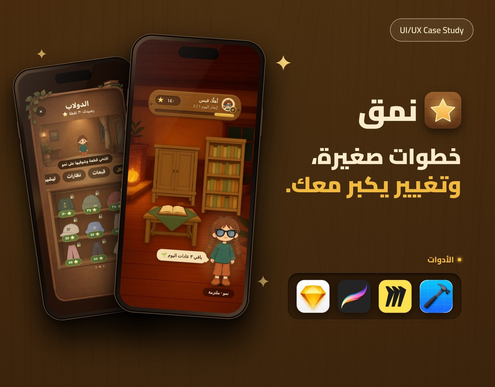
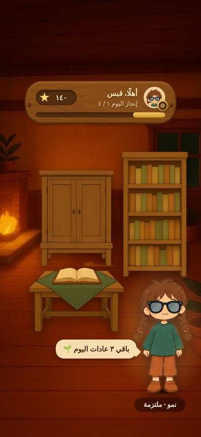
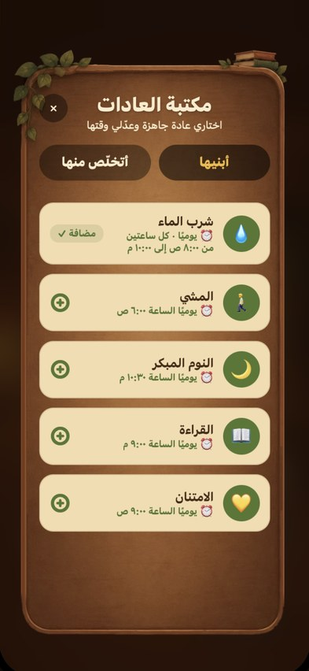
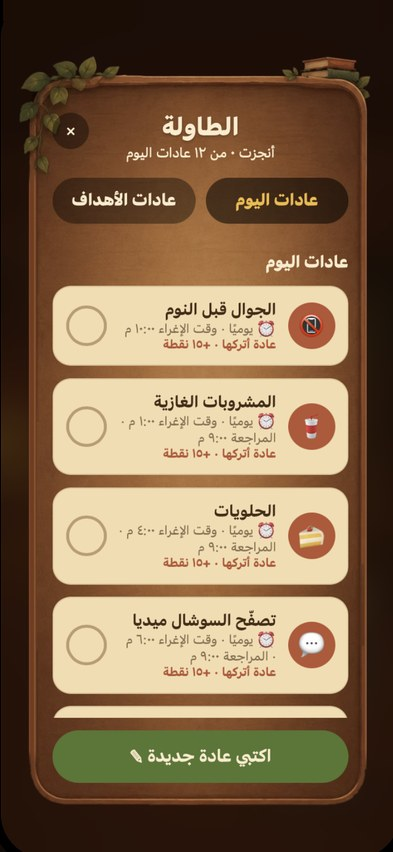
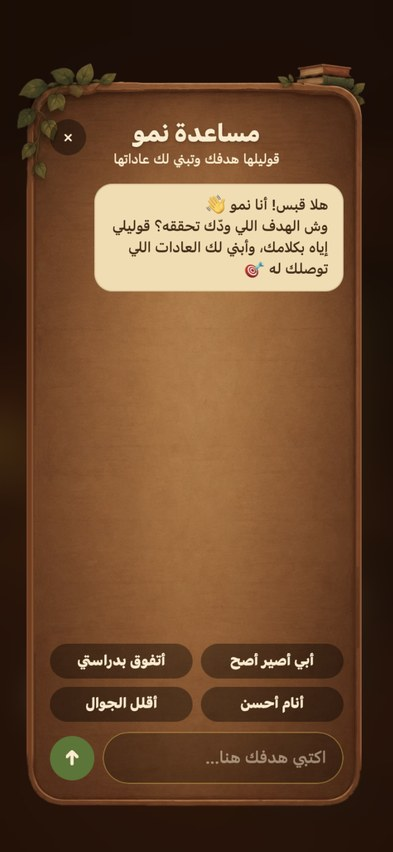
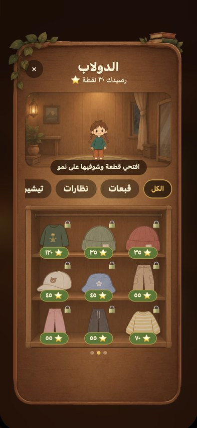
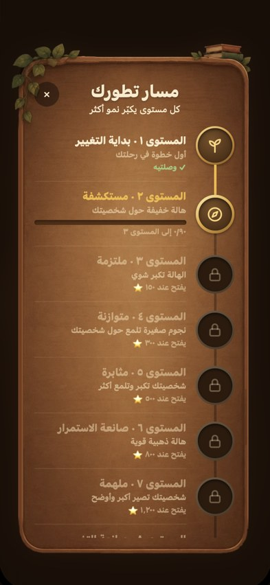

<div align="center">



# نمق · NAMQ

**Small steps, real change.** — خطوات صغيرة، وتغيير يكبر معك.

An Arabic iOS app that helps you build good habits and break unwanted ones — inside a cozy wooden room where your companion grows with every achievement.


</div>

---

## ✨ Overview

NAMQ turns personal goals into a daily habit plan generated by AI, then makes the journey feel rewarding: every completed habit earns stars, stars unlock outfits for your companion, and your progress is celebrated through levels, badges, and festive screens.

Instead of tabs, the app is a **room** — each piece of furniture opens a feature.

## 📱 Screens

<div align="center">
     
</div>

## 🌟 Features

| Feature | Description |
|---|---|
| 🏠 **The Room** | Home screen where furniture replaces tabs: the table, library, wardrobe, and your companion. |
| 📚 **Habit Library** | Ready-made habits to build or quit, added in one tap with a suggested reminder. |
| ✅ **Habit Table** | Today's habits and goal habits — check a habit off to earn stars. |
| ✏️ **Habit Editor** | Name, times per day, hourly interval, time window, and repeat days. |
| 🤖 **AI Coach** | Tap your companion, pick or write a goal, and get a weekly habit plan to review before adding. |
| 👕 **Wardrobe** | Spend stars on hats, glasses, shirts, and pants — preview them live on your companion. |
| 🏅 **Levels & Badges** | A growth path with an aura around your companion, plus bronze, silver, and gold badges. |
| 🎉 **Celebrations** | Festive screens when you finish your day or level up, with your weekly streak. |
| 🔔 **Smart Reminders** | Notifications in your companion's voice: on-time reminders, craving-time support, morning motivation, and an evening check-in. |

## 🛠 Tech Stack

- **Swift** + **UIKit**
- **UserNotifications** for local reminders
- **AVFoundation** for the animated room background
- **Sign in with Apple** (guest mode available)
- Full **RTL / Arabic** interface

## 🚀 Getting Started

1. Clone the repository
   ```bash
   git clone https://github.com/Alshaimaa00/NAMQ.git
   ```
2. Open `NAMQ.xcodeproj` in Xcode.
3. Select the **NAMQ** target → **Signing & Capabilities** → choose your team.
4. Run on an iPhone simulator or device (`Cmd + R`).

> Sign in with Apple requires an Apple Developer account. Use **guest mode** to explore the app without one.

## 📂 Project Structure

```
NAMQ/
├── NAMQ.xcodeproj
└── NAMQ/
    ├── GameViewController.swift        # The room (home)
    ├── HabitLibraryViewController.swift
    ├── MyHabitsViewController.swift    # Habit table
    ├── HabitEditorViewController.swift
    ├── CoachViewController.swift       # AI coach
    ├── WardrobeViewController.swift
    ├── ProfileViewController.swift     # Levels & badges
    ├── ReminderManager.swift           # Notifications
    ├── GameStore.swift                 # Stars, rewards, progress
    ├── Theme.swift / Components.swift  # Design system
    └── NAMQAssets.xcassets             # Characters, furniture, outfits
```

## 🎨 Design

The full UI/UX case study — research, persona, user flows, style guide, and screens — is available on Behance.

**Designed by:** Alshaimaa Alamer

---

<div align="center">نمق — رفيقك في رحلة التغيير 🌱</div>
